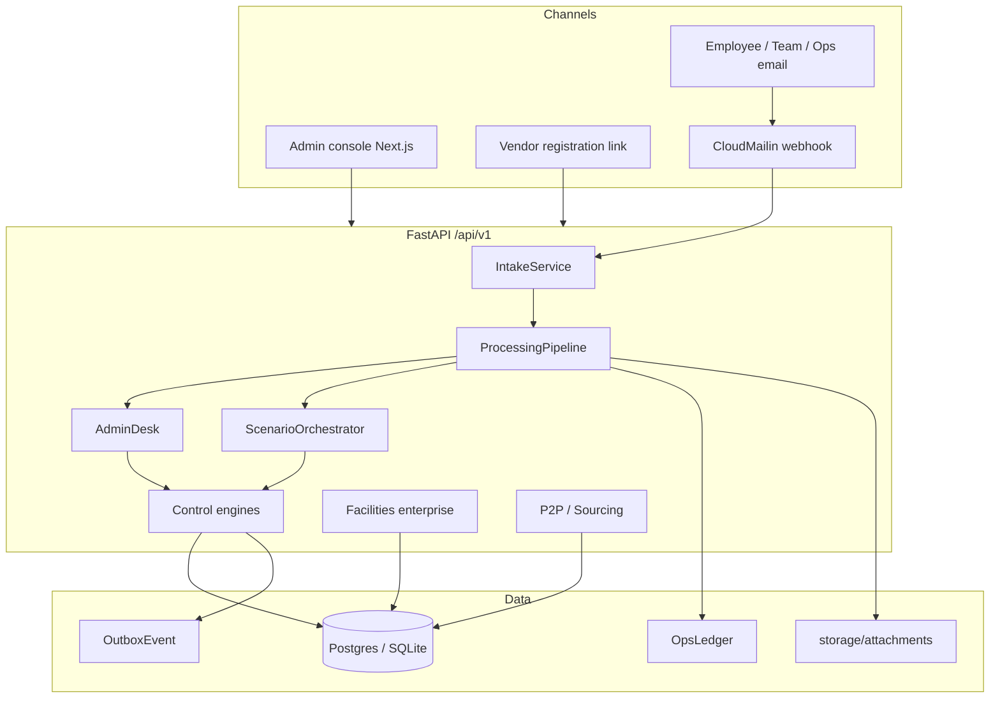
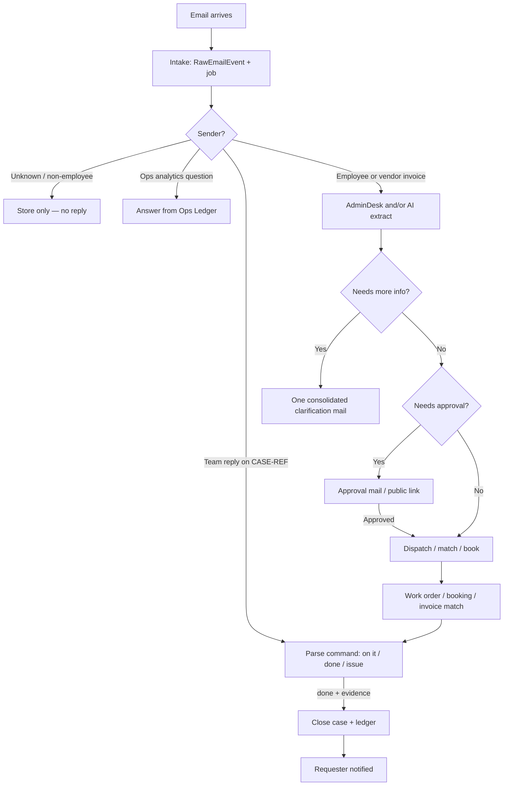
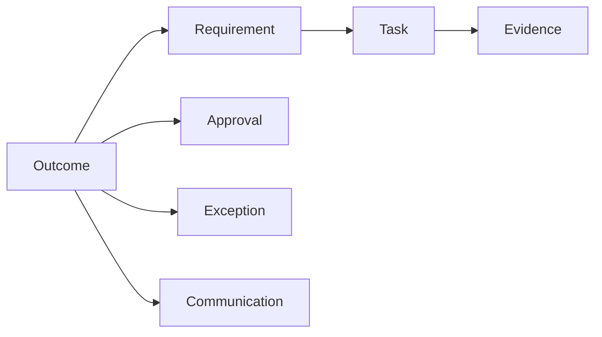
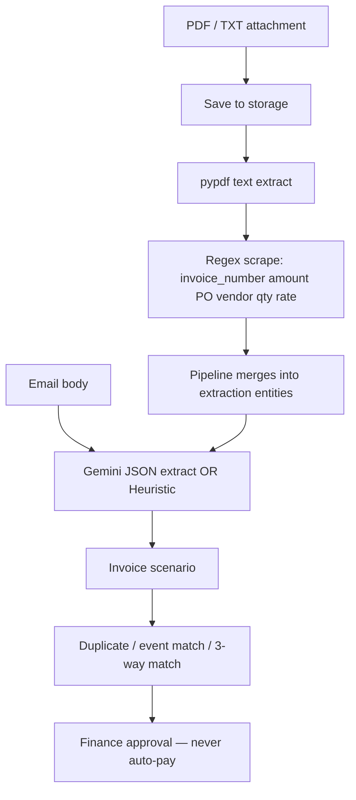
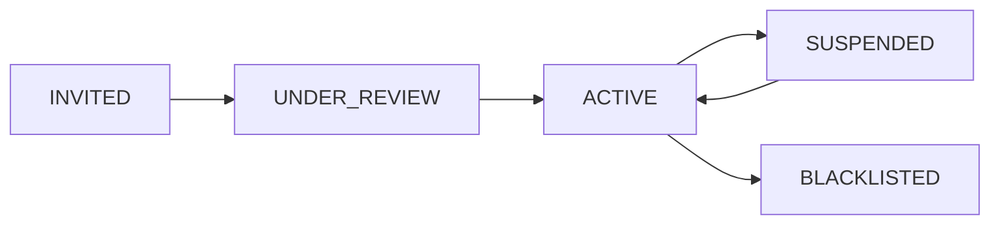
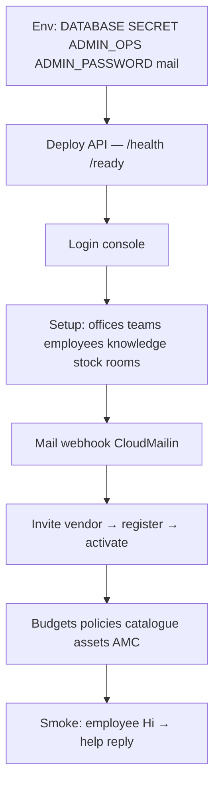

# AdminServices — Complete End-to-End System Manual

**One document for the whole product.**  
**Stack:** FastAPI (`backend/`) + Next.js console (`frontend/`) + Postgres/SQLite + email (CloudMailin / Gmail / Outlook) + Gemini (optional).  
**Live API:** `https://orchestration-pqja.onrender.com` — `/health`, `/ready`, `/api/v1/...`, `/docs`.

**Core rule:** AI interprets email. Rules validate. Controlled services execute. Humans approve money, bank changes, and sensitive actions. Evidence verifies closure. Amounts are never invented.

---

## 1. What the system is

Email-first **workplace operations** for a company (multi-branch / BFSI style):

- Employees mail requests (HVAC, visitors, supplies, travel, onboarding, meetings, invoices…).
- The platform opens a **case (Outcome)**, routes work, asks approvals when needed, tracks spend on an **ops ledger**, closes with evidence.
- The **admin console** is for setup, visibility, vendors, budgets, facilities masters — not the daily employee UX.
- Vendors use an **invite link only** (no vendor app).

| Actor | Channel | Authority |
|-------|---------|-----------|
| Employee | Email | Open/update their cases |
| Team inbox (Facilities, IT, …) | Reply on case thread | `on it`, `done`, `issue: …`, `assign to …` |
| Ops / company admin | Ops mailbox + console | Approvals, vendors, analytics, Setup |
| Approver | Approval mail / signed link | Approve/reject |
| Vendor | `/vendor-register/{token}` | Submit profile only |

---

## 2. High-level architecture



| Layer | Path |
|-------|------|
| API | `backend/app/api/routes/` |
| Pipeline | `backend/app/engine/pipeline.py` |
| Desk | `backend/app/agent/desk.py` |
| Scenarios | `backend/app/engine/scenarios.py` |
| Outcome spine | `backend/app/engine/outcome_engine.py`, `outcome_spine.py` |
| Engines | `backend/app/engines/` (Approval, Budget, Evidence, Matching, Rate, Resource, SLA) |
| AI | `backend/app/ai/` (Gemini + Heuristic) |
| Facilities | `backend/app/services/facilities_enterprise.py`, `facilities_ops.py` |
| Vendors | `backend/app/services/vendor_lifecycle.py` |
| Workers | `backend/app/workers/runner.py`, `hold_sweeper.py` |

---

## 3. End-to-end email case flow



**What “done” means:** case opened → routed → (approval if needed) → work executed → evidence → requester informed → ledger remembers who/what/spend.

### 3.1 Processing stages

`INTAKE → QUEUED → AI_INTERPRETATION → … → OUTCOME_ENGINE → HUMAN_REVIEW | COMMUNICATION → COMPLETED | FAILED`

### 3.2 Intake details (`IntakeService`)

1. Compute idempotency key → dedupe.
2. Safety scan subject/body.
3. Persist attachments to `STORAGE_PATH/attachments/{tenant}/{event_key}/`.
4. For PDF/txt: extract text + scrape invoice fields (number, amount, PO, vendor, qty, rate).
5. Store `RawEmailEvent` (no raw bytes in DB).
6. Enqueue `PROCESS_EMAIL` job (or webhook background process).

### 3.3 Pipeline branches (`ProcessingPipeline`)

| Branch | Behaviour |
|--------|-----------|
| Ops/team reply with case ref | Verify sender → desk/legacy command |
| Ops analytics | Ledger Q&A — no new case |
| `ACCEPT_REQUESTS_FROM=employees` + unknown sender | Store only |
| New request + `AGENT_MODE` | **AdminDesk** may finish the case |
| Else | LLM extract → route → **ScenarioOrchestrator** |

---

## 4. Outcome spine (every case)



| Object | Role |
|--------|------|
| **Outcome** | The case (`FAC-…`, `INV-…`, `ROOM-…`) |
| **Requirement** | What must be true (fulfil, match, book…) |
| **Task** | Work unit (WO, approval, dispatch…) |
| **Evidence** | Proof (photo, SES, acceptance) |
| **Approval** | Human gate |
| **Exception** | Blocker (duplicate invoice, missing PO…) |
| **Communication** | Every outbound/inbound mail logged |

---

## 5. Control engines (deterministic)

| Engine | File | Working |
|--------|------|---------|
| **ApprovalEngine** | `engines/approval.py` | Routes from `PolicyRule` (APPROVAL family); SoD checks |
| **BudgetEngine** | `engines/budget.py` | `available = revised − reserved − committed − actual − accrued`; reserve → commit → accrue → actual → transfer |
| **EvidenceEngine** | `engines/evidence.py` | Blocks verified close if mandatory evidence missing |
| **MatchingEngine** | `engines/matching.py` | 3-way PO + GRN/SES + invoice |
| **RateEngine** | `engines/rate.py` | Rates from contract rate cards / policy |
| **ResourceEngine** | `engines/resource.py` | Conflict-safe room holds |
| **SlaEngine** | `engines/sla.py` | Response/resolution clocks from policy or catalogue |

**Budget methods:** `check`, `reserve`, `release_reservation`, `commit`, `relieve_commitment`, `post_actual`, `accrue`, `transfer`, `forecast_at_completion`.

---

## 6. AI (Gemini) and PDF invoices



| Mode | When |
|------|------|
| **Gemini** | `GEMINI_API_KEY` set — structured JSON extraction |
| **Heuristic** | No key — keyword rules; still uses PDF scrape |
| **Digital PDF** | Text layer → amount stored |
| **Scanned PDF** | No text layer → ask human / flag `extract_note` |

Gemini **does not** approve payment, invent amounts, or change bank details.

---

## 7. Module flows

### 7.1 Facilities request (HVAC example)

1. Employee mails “AC not working on 4th floor”.
2. Desk opens Outcome + ServiceTicket + WorkOrder.
3. AMC gate: if asset covered → prefer AMC vendor call (no new buy).
4. Budget/SLA engines apply.
5. WO email to Facilities (and vendor hint).
6. Team `done` → evidence → close → ledger.

**Work order statuses:**  
`OPEN → TRIAGED → APPROVED → ASSIGNED → IN_PROGRESS → PENDING_PARTS → PENDING_ACCEPTANCE → CLOSED | CANCELLED`

### 7.2 Meeting room

ClientMeetingOrchestrator: hold room → confirm → visitors/parking/catering modules as needed → shared Outcome→Requirement→Task spine.

### 7.3 Vendor invoice

Extract fields → create `Invoice` → duplicate check → match event SES or PO+GRN → mismatches raise exceptions → on MATCH request finance approval → ERP handoff status tracked (payment never invented).

### 7.4 Vendor lifecycle



Only **ACTIVE** vendors are used for WO hints and stock reorder.  
Tiers after score: PREFERRED ≥80, APPROVED ≥55, else CONDITIONAL.

### 7.5 P2P / sourcing

Purchase request → PO → GRN / SES → invoice match-and-post.  
Sourcing: requirement → RFQ → quotes → compare → award (ACTIVE vendors only).

### 7.6 Soft services

Schedule → generate rounds → complete with SES link for certification.

### 7.7 PM sweeper

Overdue `PreventiveSchedule` → creates desk outcomes/WOs automatically.

---

## 8. Setup: empty company → live



### 8.1 Local boot

```bash
cd backend && python -m venv .venv && .\.venv\Scripts\activate
pip install -r requirements.txt && copy .env.example .env
uvicorn app.main:app --reload --port 8000
# optional: python -m app.workers.runner

cd frontend && npm install && npm run dev
```

### 8.2 Production (Render) env

| Variable | Purpose |
|----------|---------|
| `APP_ENV=production` | Strict checks |
| `SECRET_KEY` | Strong JWT secret |
| `ADMIN_PASSWORD` | Strong (not admin123) when `AUTO_SEED` |
| `ADMIN_OPS_EMAIL` | Required ops mailbox |
| `DATABASE_URL` | Supabase **session** pooler `:5432` |
| `CLOUDMAILIN_*` | Inbound webhook + outbound |
| `PUBLIC_BASE_URL` / `FRONTEND_PUBLIC_URL` | Approval + vendor links |
| `GEMINI_API_KEY` | Optional AI |
| `INPROCESS_SWEEPER_SECONDS` | Sweeps on web dyno |
| Health path | `/health` (DB boot is background; `/ready` for DB) |

Startup: port binds immediately; schema/seed runs in background thread so Render port scan succeeds.

---

## 9. API map (`/api/v1`)

| Prefix | Working |
|--------|---------|
| `/auth` | Login |
| `/intake` | Ingest/process emails, worker tick |
| `/outcomes`, `/tasks`, `/evidence`, `/approvals` | Case spine |
| `/reviews` | Human review queue |
| `/ops` | Resources, invoices, failures, SLA tick, holds sweep, AI health |
| `/entities` | Legal entities |
| `/budgets` | Create, reserve, commit, accrue, actual, transfer |
| `/policies` | Policy rules |
| `/assets` | Register, status, reassign |
| `/facilities` | PM, soft, incidents, spaces, catalogue, WO, inventory, chargeback, compliance, BCP, ESG, dashboard |
| `/admin-modules` | Mailroom, joiner/mover/leaver, utilities |
| `/amc`, `/projects` | AMC obligations, projects |
| `/p2p` | PR, PO, GRN, SES, invoice post |
| `/sourcing` | RFQ lifecycle |
| `/workplace` | Seats, visitors |
| `/fleet`, `/travel` | Trips, itineraries |
| `/control-tower` | Summary |
| `/vendors` | Invite, activate, suspend, score |
| `/integrations/gmail\|outlook` | OAuth + poll |
| `/webhooks/cloudmailin` | Inbound mail |
| `/setup` | Company data import |
| `/learning` | Learning records |
| `/public/approvals` | Signed approve/reject pages |
| `/public/vendors` | Vendor self-register |

Also: `GET /health`, `GET /ready`.

---

## 10. Workers and sweepers

| Job | What it does |
|-----|----------------|
| `PROCESS_EMAIL` worker | Claim queue → pipeline |
| In-process sweeper | `run_all_sweeps` on interval |
| Proposal holds | Remind / expire room holds |
| Recover stuck emails | Re-process stale stages |
| Desk lifecycle | Auto-close, info nudges, approval reminders |
| SLA tick | Overdue / escalate |
| PM sweeper | Due PM → cases |
| Visitor expiry | Expire open passes |
| Outbox flush | Send pending integration/notify events |
| Admin digest | Daily ops digest when configured |

---

## 11. Complete data dictionary (every table / field)

All `TimestampMixin` tables also have **`created_at`**, **`updated_at`**.

### 11.1 Organisation (`models/org.py`)

**Tenant** — `tenant_id`, `name`, `region`, `status`, `default_timezone`, `default_currency`, `retention_profile`

**LegalEntity** — `entity_id`, `tenant_id`, `code`, `legal_name`, `country`, `currency`, `tax_ids`, `registrations`, `status`, `effective_from`, `effective_to`

**Person** — `person_id`, `tenant_id`, `entity_id`, `email`, `name`, `role`, `department`, `manager_id`, `site_id`, `allowed_site_ids`, `is_active`, `password_hash`

**Location** — `location_id`, `tenant_id`, `parent_id`, `type` (REGION/CITY/BRANCH/BUILDING/FLOOR/ZONE/ROOM/DESK), `name`, `code`, `alias`, `site_id`, `attributes` (address, cost_centre, owner_email, criticality, service_bundle, … — **no lease/rent**)

**Resource** — `resource_id`, `tenant_id`, `type`, `name`, `location_id`, `status`, `allocated_to_person_id`, `attributes`

**RoomBooking** — `booking_id`, `tenant_id`, `resource_id`, `outcome_id`, `room_name`, `status` (HELD/CONFIRMED/RELEASED/CANCELLED/EXPIRED), `starts_at`, `ends_at`, `hold_expires_at`, `reminder_sent_at`, `is_offsite`, `attributes`

**Asset** — `asset_id`, `tenant_id`, `type`, `name`, `location_id`, `vendor_id`, `contract_id`, `status`, `assignee_email`, `tag`, `attributes` (make, model, serial, warranty, criticality, …)

**StockSku** — `sku_id`, `tenant_id`, `location_id`, `sku_code`, `name`, `category`, `qty_on_hand`, `qty_reserved`, `reorder_min`, `reorder_qty`, `safety_stock`, `max_stock`, `unit`, `pack_size`, `bin_code`, `batch_code`, `expires_on`, `controlled_item`, `hazardous`, `standard_item`, `contracted_rate`, `lead_time_days`, `min_order_qty`, `substitute_sku_code`, `gl_account`, `budget_head`, `chargeback_rule_code`, `vendor_id`, `status`, `attributes`

**StockReservation** — `reservation_id`, `tenant_id`, `sku_id`, `outcome_id`, `quantity`, `status` (HELD/ISSUED/RELEASED/EXPIRED), `notes`

**ServiceCatalog** — `service_id`, `tenant_id`, `category`, `name`, `mandatory_questions`, `sla_hours`, `owner_role`, `evidence_rules`

**Vendor** — `vendor_id`, `tenant_id`, `entity_id`, `name`, `category`, `contact_email`, `location`, `status` (INVITED/UNDER_REVIEW/ACTIVE/SUSPENDED/BLACKLISTED), `approved_services`, `pricing`, `legal_name`, `gstin`, `pan`, `cin`, `msme_number`, `contact_name`, `contact_phone`, `website`, `registered_address`, `coverage_states`, `coverage_cities`, `coverage_location_ids`, `documents`, `compliance`, `references`, `manpower`, `equipment`, `financial`, `sla_terms`, `score`, `score_breakdown`, `vendor_tier`, `invite_token`, `invite_expires_at`, `registration_submitted_at`, `invited_by`, `invited_at`, `activated_at`, `suspended_reason`, `notes`, `contract_id`

**VendorCoverage** — `coverage_id`, `tenant_id`, `vendor_id`, `state`, `city`, `location_id`, `team_count`, `notes`

**Contract** — `contract_id`, `tenant_id`, `vendor_id`, `name`, `rate_card`, `status`, `start_date`, `end_date`

**PurchaseOrder** — `po_id`, `tenant_id`, `vendor_id`, `po_number`, `description`, `quantity`, `unit_rate`, `currency`, `status`, `contract_id`

**Receipt** — `receipt_id`, `tenant_id`, `po_id`, `quantity_received`, `received_date`, `status`, `notes`

**Invoice** — `invoice_id`, `tenant_id`, `vendor_id`, `po_id`, `receipt_id`, `invoice_number`, `amount`, `quantity`, `unit_rate`, `currency`, `match_status`, `bank_details_changed`, `file_hash`, `outcome_id`, `erp_handoff_status`, `attributes`

**OutcomeTemplate** — `template_id`, `tenant_id`, `code`, `name`, `category`, `case_prefix`, `requirements`, `tasks`, `mandatory_fields`, `evidence_rules`, `approval_rules`, `notification_rules`, `is_active`

**BusinessRule** — `rule_id`, `tenant_id`, `entity_id`, `code`, `category`, `description`, `config`, `version`, `effective_from`, `effective_to`, `is_active`

**PolicyRule** — `policy_id`, `tenant_id`, `entity_id`, `code`, `name`, `rule_family`, `owner_role`, `condition`, `decision`, `reason_template`, `priority`, `version`, effective dates, `is_active`

**Budget** — `budget_id`, `tenant_id`, `entity_id`, `cost_centre`, `category`, `period`, `currency`, `original_amount`, `revised_amount`, `reserved_amount`, `committed_amount`, `actual_amount`, `accrued_amount`, `status`, `attributes`

**OutboxEvent** — `outbox_id`, `tenant_id`, `entity_id`, `event_type`, `aggregate_type`, `aggregate_id`, `payload`, `idempotency_key`, `status` (PENDING/SENT/FAILED/DEAD), `attempts`, `last_error`, `available_at`, `sent_at`

**NotificationTemplate** — `template_id`, `tenant_id`, `code`, `communication_type`, `subject_template`, `body_template`, `is_active`

### 11.2 Outcome spine (`models/outcome.py`)

**Outcome** — `outcome_id`, `tenant_id`, `entity_id`, `site_id`, `case_reference`, `template_id`, `template_code`, `category`, `title`, `summary`, `owner_person_id`, `requester_email`, `requester_person_id`, `status`, `readiness_pct`, joining/permanent readiness fields, `due_at`, `business_event_id`, `conversation_id`, `priority`, `facts`, `blockers`, `closed_at`, `verified_at`

**Requirement** — `requirement_id`, `tenant_id`, `outcome_id`, `code`, `title`, `applicability`, `status`, `is_mandatory`, `is_blocker`, `evidence_rule`, `evidence_required`, `notes`

**Task** — `task_id`, `tenant_id`, `outcome_id`, `requirement_id`, `code`, `title`, `description`, `owner_role`, `owner_person_id`, `status`, `due_at`, `sla_hours`, `task_group`, `is_mandatory`, `evidence_required`, `depends_on_task_codes`, `blocked_by`, `is_blocked`, `resolution`, `completed_at`, `verified_at`

**TaskDependency** — `dependency_id`, `task_id`, `depends_on_task_id`, `dependency_type`

**Approval** — `approval_id`, `tenant_id`, `outcome_id`, `task_id`, `approval_type`, `approver_person_id`, `approver_role`, `decision`, `reason`, `decided_at`, `payload`

**ExceptionRecord** — `exception_id`, `tenant_id`, `outcome_id`, `task_id`, `exception_type`, `severity`, `title`, `description`, `owner_person_id`, `owner_role`, `status`, `options`, `resolution`, `resolved_at`

**Evidence** — `evidence_id`, `tenant_id`, `outcome_id`, `task_id`, `requirement_id`, `evidence_type`, `file_path`, `record_ref`, `description`, `status`, `submitted_by`, `verifier_person_id`, `verified_at`, `metadata_json`

**Communication** — `message_id`, `tenant_id`, `conversation_id`, `outcome_id`, `thread_id`, `gmail_message_id`, `provider_message_id`, `communication_type`, `sender`, `recipients`, `subject`, `body`, `idempotency_key`, `sent_at`

**AuditLog** — `audit_id`, `tenant_id`, `actor`, `action`, `entity_type`, `entity_id`, `before`, `after`, `source`, `correlation_id`, `timestamp`, `created_at`

**VendorIssue** — `issue_id`, `tenant_id`, `outcome_id`, `issue_type`, `workstream`, `title`, `allegation_status`, `description`, `severity`

### 11.3 Intake (`models/intake.py`)

**RawEmailEvent** — `event_id`, `tenant_id`, `processing_id`, `idempotency_key`, `provider`, `provider_message_id`, `provider_conversation_id`, `gmail_message_id`, `gmail_thread_id`, `source`, `sender`, `recipients`, `cc`, `subject`, `body_text`, `body_html`, `body_for_ai`, `received_at`, `attachments` (meta + extracted_text/scraped_fields), `headers`, `safety_flags`, `processing_stage`, `conversation_id`, `deduplicated`

**Conversation** — `conversation_id`, `tenant_id`, `thread_id`, `requester_email`, `requester_person_id`, `current_outcome_id`, `status`, `subject`, `facts`, `missing_information`

**ProcessingJob** — `job_id`, `tenant_id`, `job_type`, `status`, `event_id`, `payload`, `idempotency_key`, `attempts`, `max_attempts`, `last_error`, `locked_at`, `locked_by`, `available_at`, `completed_at`, `stage`

**DownstreamAction** — `action_id`, `tenant_id`, `action_type`, `idempotency_key`, `entity_type`, `entity_id`, `status`, `result`

**AIDecision** — `decision_id`, `tenant_id`, `event_id`, `conversation_id`, `model`, `model_version`, `prompt_version`, `confidence`, `output`, `recommendation`, `rationale`, `route`, `human_corrected`, `correction`, `corrected_by`

**HumanReviewItem** — `review_id`, `tenant_id`, `event_id`, `conversation_id`, `ai_decision_id`, `status`, `reason`, `assigned_to`, `resolution`, `resolved_at`

### 11.4 Company (`models/company.py`)

**Department** — `department_id`, `tenant_id`, `code`, `name`, `location_id`, `categories`, `primary_email`, `backup_emails`, `approver_email`, `sla_hours`, `spend_approval_limit`, `is_active`, `notes`, `handover_info`

**KnowledgeEntry** — `entry_id`, `tenant_id`, `key`, `section`, `title`, `content`, `is_active`

**SiteService** — `service_id`, `tenant_id`, `site`, `code`, `name`, `delivery_model` (INCLUDED/CONTRACT/SUBSIDISED/CHARGEABLE/OUTSOURCED), `provider`, `owner_department`, `unit`, `rate`, `currency`, `included_limit`, `premium_triggers`, `premium_rate`, `evidence_rule`, `service_family`, `sla_response_hours`, `sla_resolution_hours`, `chargeback_rule_code`, `fulfilment_checklist`, `closure_codes`, `primary_vendor_id`, `backup_vendor_id`, `effective_from`, `effective_to`, `is_active`, `notes`

**CostCentre** — `cost_centre_id`, `tenant_id`, `code`, `name`, `department`, `approver_name`, `approver_email`, `is_active`

**ServiceTicket** — `ticket_id`, `tenant_id`, `outcome_id`, `reference`, `category`, `title`, `description`, `location`, `priority`, `status`, `department_code`, `assignee_email`, `requester_email`, `sla_due_at`, `resolved_at`, `details`

**LearningRecord** — `record_id`, `tenant_id`, `outcome_id`, `case_reference`, `category`, `request_text`, `ai_plan`, `corrections`, `final_plan`, `execution`, `closure_type`, `verified`, `reopen_count`, `learning_eligible`

**VisitorPass** — `pass_id`, `tenant_id`, `outcome_id`, `pass_code`, `visitor_name`, `company`, `host_email`, visit date/time, `office`, `vehicle_number`, `parking_slot`, `purpose`, `status`, `attributes`

### 11.5 Finance (`models/finance.py`)

**CostRequirement** — `cost_id`, `tenant_id`, `entity_id`, `outcome_id`, `vendor_id`, `budget_id`, `category`, `currency`, `estimated_amount`, `reserved_amount`, `approved_amount`, `committed_amount`, `reported_amount`, `invoiced_amount`, `posted_amount`, `paid_amount`, `status`, `notes`, `attributes`

**ServiceEntry (SES)** — `ses_id`, `tenant_id`, `entity_id`, `po_id`, `contract_id`, `vendor_id`, `outcome_id`, `quantity`, `unit_rate`, `amount`, `currency`, `period_from`, `period_to`, `status` (DRAFT/SUBMITTED/ACCEPTED/REJECTED), `notes`, `accepted_at`

**ErpHandoff** — `handoff_id`, `tenant_id`, `entity_id`, `invoice_id`, `cost_id`, `direction`, `erp_system`, `erp_document_ref`, `status`, `payload`, `last_error`, `idempotency_key`, `sent_at`, `acknowledged_at`

### 11.6 Ops ledger & integrations

**OpsLedgerEvent** — `event_id`, `tenant_id`, `occurred_at`, `actor_email`, `actor_role`, `department_code`, `location_id`, `category`, `outcome_id`, `case_reference`, `event_type`, `amount`, `currency`, `quantity`, `unit`, `sku_code`, `asset_tag`, `summary`, `payload`  
*(Operational memory — not ERP books.)*

**IntegrationCredential** — `credential_id`, `tenant_id`, `provider`, `account_email`, `token_json`, `scopes`, `status`, `last_synced_at`

### 11.7 Facilities (`models/facilities.py`)

**PreventiveSchedule** — `schedule_id`, `tenant_id`, `entity_id`, `asset_id`, `location_id`, `job_plan_id`, `title`, `checklist`, `frequency_days`, `next_due_at`, `last_completed_at`, `owner_role`, `safety_permit_required`, `competency_required`, `status`, `attributes`

**PmJobPlan** — `plan_id`, `tenant_id`, `code`, `title`, `asset_types`, `tasks`, `parts`, `estimated_hours`, `safety_permit`, `competency`, `evidence_required`, `status`, `attributes`

**SoftServiceSchedule** — `schedule_id`, `tenant_id`, `location_id`, `service_type` (HOUSEKEEPING/HYGIENE/PEST/LANDSCAPING/WASTE), `frequency_days`, `vendor_id`, `contract_id`, `checklist`, `next_due_at`, `status`, `attributes`

**SoftServiceRound** — `round_id`, `tenant_id`, `schedule_id`, `location_id`, `service_type`, `scheduled_for`, `completed_at`, `score`, `findings`, `evidence_ids`, `ses_id`, `status`, `notes`

**IncidentRecord** — `incident_id`, `tenant_id`, `entity_id`, `outcome_id`, `location_id`, `work_order_id`, `incident_type`, `severity`, `title`, `description`, `status`, `reported_by`, `deterministic_urgent`, `fanout_notified`, `capa`, `closed_at`

**WorkOrder** — `work_order_id`, `tenant_id`, `entity_id`, `outcome_id`, `location_id`, `asset_id`, `service_code`, `title`, `description`, `priority` (P1–P4), `status`, `requester_email`, `assignee_email`, `vendor_id`, `amc_obligation_id`, `budget_id`, `sla_response_at`, `sla_resolve_at`, `acknowledged_at`, `attended_at`, `resolved_at`, `closed_at`, `closure_code`, `evidence_ids`, `parts_used`, `labour_hours`, `cost_amount`, `duplicate_of`, `attributes`

**SpaceUnit** — `space_id`, `tenant_id`, `location_id`, `parent_space_id`, `code`, `name`, `space_type`, `room_type`, `capacity_seats`, `area_sqft`, `amenities`, `accessibility`, `hvac_zone`, `fire_zone`, `status`, `attributes`

**EnterpriseServiceItem** — `item_id`, `tenant_id`, `service_code`, `service_family`, `service_item`, `description`, `inclusions`, `exclusions`, `dependencies`, `eligible_requesters`, `applicable_site_types`, `criticality`, `operating_window`, `mandatory_fields`, `attachment_requirements`, `approval_conditions`, `fulfilment_checklist`, `sla_response_hours`, `sla_attendance_hours`, `sla_resolution_hours`, `sla_restoration_hours`, `pause_rules`, `business_calendar`, `owner_team`, `primary_vendor_id`, `backup_vendor_id`, `escalation_chain`, `after_hours_contact`, `unit_of_measure`, `rate`, `currency`, `tax_code`, `minimum_billing`, `escalation_formula`, `free_entitlement`, `chargeback_rule_code`, `closure_codes`, `evidence_retention_days`, `reopen_window_hours`, `status`, `attributes`

**ComplianceRequirement** — `requirement_id`, `tenant_id`, `requirement_code`, `law_or_standard`, `jurisdiction`, `applicability`, `location_ids`, `asset_ids`, `licence_type`, `authority`, `certificate_number`, `issue_date`, `expiry_date`, `renewal_lead_days`, `owner_email`, `reviewer_email`, `approver_email`, `provider`, `evidence_refs`, `inspection_frequency_days`, `findings`, `corrective_actions`, `retention_days`, `status`, `risk_rating`, `grace_days`, `business_restriction`, `attributes`

**RiskRegisterItem** — `risk_id`, `tenant_id`, `location_id`, `title`, `category`, `likelihood`, `impact`, `inherent_score`, `residual_score`, `controls`, `owner_email`, `treatment`, `status`, `next_review_date`, `attributes`

**BcpPlan** — `plan_id`, `tenant_id`, `location_id`, `plan_type`, `title`, `bia`, `dependencies`, `contact_tree`, `command_roles`, `assembly_points`, `alternate_workspace`, `vendor_mobilisation`, `critical_spares`, `status`, `last_drill_at`, `attributes`

**EmergencyDrill** — `drill_id`, `tenant_id`, `plan_id`, `location_id`, `conducted_at`, `participants`, `score`, `lessons`, `actions`, `status`, `notes`

**ChargebackRule** — `rule_id`, `tenant_id`, `code`, `name`, `method` (DIRECT/SHARED_FIXED/AREA/HEADCOUNT/METERED/TRANSACTION/HYBRID/CENTRAL), `drivers`, `allocations`, `subsidy_pct`, `status`, `attributes`

**BudgetTransfer** — `transfer_id`, `tenant_id`, `source_budget_id`, `dest_budget_id`, `amount`, `justification`, `approved_by`, `status`, `attributes`

**ItemEntitlement** — `entitlement_id`, `tenant_id`, `sku_code`, `role`, `location_type`, `monthly_qty`, `max_per_request`, `requires_approval_above`, `status`

**InventoryCycleCount** — `count_id`, `tenant_id`, `location_id`, `sku_id`, `counted_qty`, `system_qty`, `variance`, `counted_by`, `counted_at`, `status`, `notes`

**EsgMetric** — `metric_id`, `tenant_id`, `location_id`, `metric_type`, `period`, `value`, `unit`, `source`, `attributes`

### 11.8 Service-defined tables

**AmcObligation** — `obligation_id`, `tenant_id`, `contract_id`, `asset_id`, `title`, `coverage`, `sla_hours`, `inclusions`, `exclusions`, `next_pm_due`, `status`, `notes`

**ProjectRecord** — `project_id`, `tenant_id`, `entity_id`, `code`, `name`, `project_type`, `status`, `budget_amount`, `currency`, `location_id`, `vendor_id`, `milestones`, `attributes`

**FleetVehicle** — `vehicle_id`, `tenant_id`, `registration`, `vehicle_type`, `capacity`, `status`, `attributes`

**TripRecord** — `trip_id`, `tenant_id`, `outcome_id`, `vehicle_id`, rider/pickup/dropoff/schedule fields, `status`, `rate_amount`, `currency`, `notes`

**TravelItinerary** — `itinerary_id`, `tenant_id`, `outcome_id`, `traveller_email`, `purpose`, `segments`, `duty_of_care`, `status`, `attributes`

**SourcingRequirement** — `requirement_id`, `tenant_id`, `entity_id`, `outcome_id`, title/category/description/location, `status`, `award_vendor_id`, `attributes`

**RfqRound** — `rfq_id`, `tenant_id`, `requirement_id`, `vendor_ids`, `due_at`, `status`, `notes`

**VendorQuote** — `quote_id`, `tenant_id`, `rfq_id`, `vendor_id`, amount/currency/lead_time, `notes`, `score`, `status`

**MailItem** — `mail_id`, `tenant_id`, `direction`, carrier/tracking, recipient/sender, `location_id`, `status`, `outcome_id`, `notes`, `attributes`

**WorkplaceLifecycleCase** — `case_id`, `tenant_id`, `person_id`, `person_email`, `event_type` (JOINER/MOVER/LEAVER), `site_id`, `outcome_id`, `checklist`, `status`, `notes`

**UtilityReading** — `reading_id`, `tenant_id`, `location_id`, `meter_code`, `utility_type`, `reading_value`, `unit`, `reading_at`, `attributes`

---

## 12. Enterprise posture (V3) — what closed vs excluded

**Target:** Kapil V3 blueprint enterprise-ready — **not** a prototype.

| Closed in code | Notes |
|----------------|-------|
| Context Gateway tools wired into pipeline | `get_requester`, `resolve_location`, `get_site_services`, `check_amc`, `get_budget`, `get_rate` — facts carry source/freshness/unavailable |
| AIGovernance | Model registry + emergency stop + confidence gate on extract |
| Financial segregation | Team `done, INR X` → `CostRequirement.reported_amount` only; OpsLedger = operational memory; paid only via ERP |
| Unified spine for all templates | Meeting/invoice materialize Outcome→Requirement→Task; specialists are **module helpers** |
| Contract lifecycle | Amend / SLA credits / penalties / terminate |
| Vendor day-2 workspace | QUOTE / EVIDENCE / INVOICE / PROGRESS submit + decide |
| M16 sealed RFQ scoring | Tech vs commercial; sealed until due/unseal |
| M23 ESG | Meter rollover, Scope1/2/3 carbon, waste manifests |
| M26 governed learning | Sign-off requires verified + human corrections; no auto prompt mutation |
| Outbox DLQ | DEAD letter queue + requeue + ERP reconcile enqueue |

| Still excluded (product decision) |
|-----------------------------------|
| Real-estate **lease** commercial masters (rent, landlord, CAM, stamp duty) |
| Mobile field / QR technician offline app / IoT GPS telemetry |

| External dependency (adapter ready; needs client credentials) |
|---------------------------------------------------------------|
| Live ERP journal post/pay (HTTP connector; stub in CI) |
| Live HRMS / SCIM IdP sync |

APIs: `/api/v1/contracts/...`, `/vendors/{id}/workspace`, `/sourcing/rfq/{id}/sealed-score`, `/utilities/meters`, `/esg/*`, `/learning/{id}/sign-off`, `/outcomes/{id}/cost`, `/outbox/dead-letters`, `/integrations/erp/reconcile`.

---

## 13. Verification smoke checklist

1. `GET /health` → ok; `GET /ready` → ready  
2. Console login with `ADMIN_EMAIL` / `ADMIN_PASSWORD`  
3. Setup: office + Facilities inbox + one employee  
4. Employee emails “Hi” → help reply  
5. Employee emails AC fault → case + WO  
6. Invite vendor → register → activate → appears on next WO  
7. Vendor PDF invoice with amount in text → `Invoice.amount` stored → match/approval (no auto-pay)  
8. Team `done, INR 12500` → CostRequirement REPORTED (not PAID); OpsLedger ops-only  
9. Control tower / facilities dashboard shows open WO / overdue PM  
10. Contract amend / vendor workspace quote / sealed RFQ unseal / learning sign-off  

---

**Document status:** Enterprise V3 close-out (excluding lease + mobile). Single source of truth — do not recreate a second docs pack.
