# AdminServices workflow

This is the map of the system in this folder. Every HTTP route is listed with the path it actually takes. The base path is `/api/v1` unless the route is `/health` or `/ready`.

One company, one set of records, two doors:

- An employee or admin writes an email. CloudMailin delivers it. The desk opens a case or answers from the records.
- An operator signs into the console. The same records are read and updated there.

A branch admin sees the offices stored on their person row. A company admin, with no office list, sees every office. Amounts in these flows are reported figures. They are not payments.

The copy on the server at `https://orchestration-pqja.onrender.com` is the last published build. This file describes the code in this folder.

## How a request moves

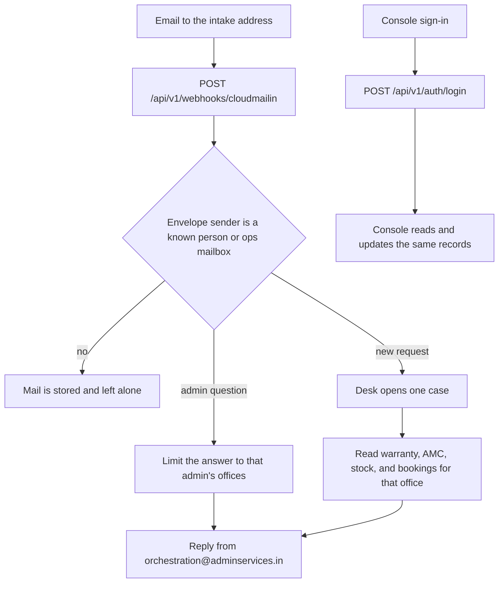

## 1. The service is awake

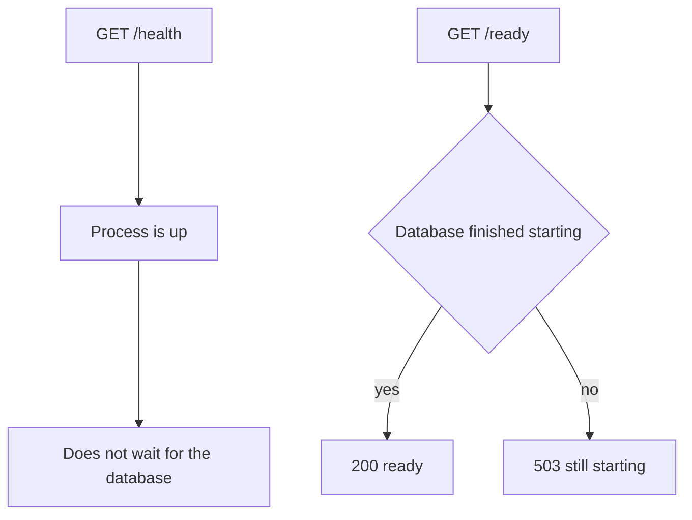

| Method | Path | What happens |
| --- | --- | --- |
| GET | `/health` | Says the process is up. A cold start can answer this before the database is ready. |
| GET | `/ready` | Says the database is ready. Returns 503 until startup finishes. |

## 2. Sign in

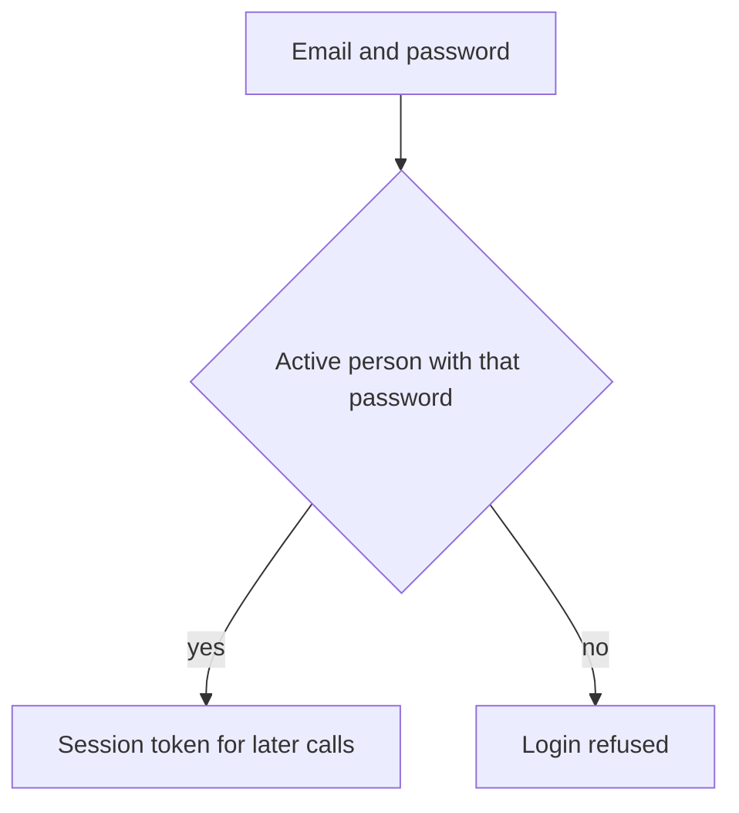

| Method | Path | What happens |
| --- | --- | --- |
| POST | `/api/v1/auth/login` | Checks the person row and returns a token. Later console calls send that token. |

## 3. Mail arrives

This is the main door. CloudMailin posts the message. The sender the desk trusts is the envelope address, not a From line that was typed by hand.

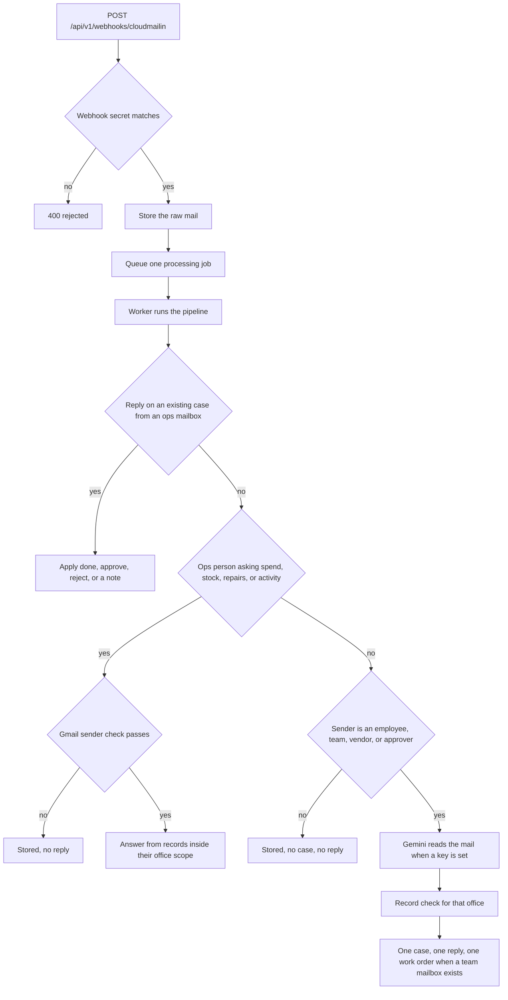

Sender check for an admin question: the message must show SPF or DKIM for that domain, or be a reply to a mail this desk already sent, or be a known ops mailbox submitted by Gmail. A script that only writes a From header does not pass.

Office scope: a company-wide role with no office list sees every branch. A branch role uses `site_id` and `allowed_site_ids`, including floors under those offices. A branch role with no office saved is refused. The reply says a company admin must assign an office. It does not show other branches.

Stock questions:

- “What stock do we have?” returns the stock list for that scope, grouped by office.
- “What is low?” or “what should we reorder?” returns only rows at or below the reorder level, plus recent replace notes.
- A Pune admin does not receive Gurugram or Hyderabad rows.

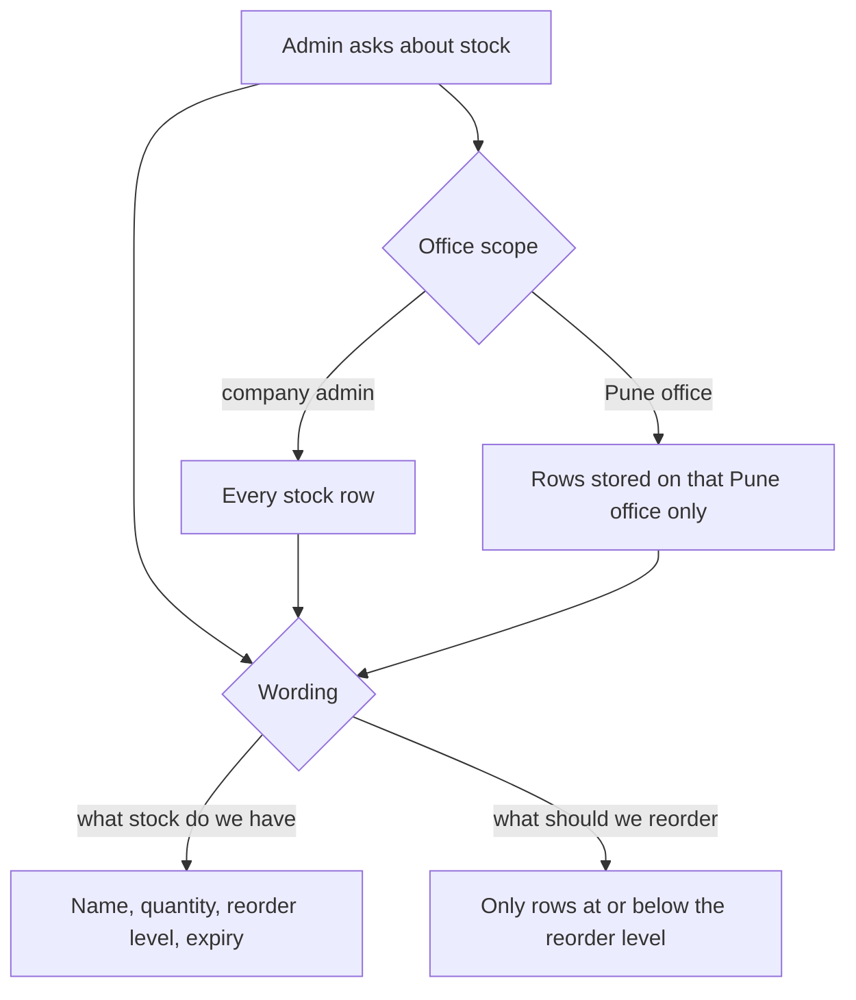

| Method | Path | What happens |
| --- | --- | --- |
| GET | `/api/v1/webhooks/cloudmailin` | Reports whether inbound mail and outbound replies are configured. No message is sent. |
| POST | `/api/v1/webhooks/cloudmailin` | Accepts one CloudMailin payload, stores it, and queues the pipeline above. |
| POST | `/api/v1/intake/emails` | Same intake for a caller that already has a normalized mail. Used by tools, not by employees. |
| POST | `/api/v1/intake/emails/{event_id}/process` | Runs the pipeline for one stored mail. |
| GET | `/api/v1/intake/emails` | Lists stored inbound mails. |
| POST | `/api/v1/intake/worker/tick` | Runs queued jobs once. The live server also runs this on its own. |

### GET /api/v1/webhooks/cloudmailin

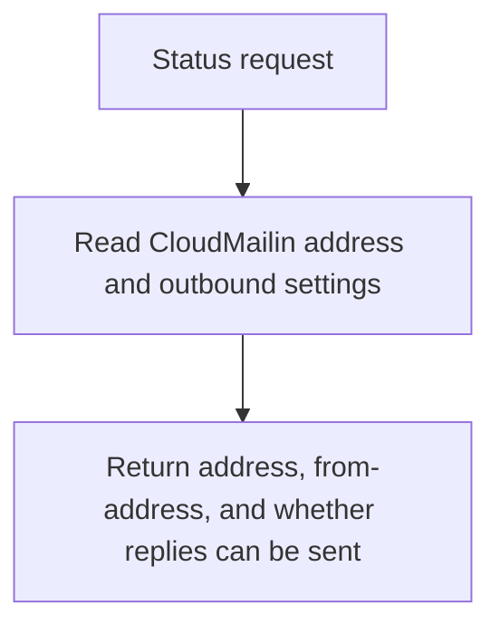

### POST /api/v1/webhooks/cloudmailin

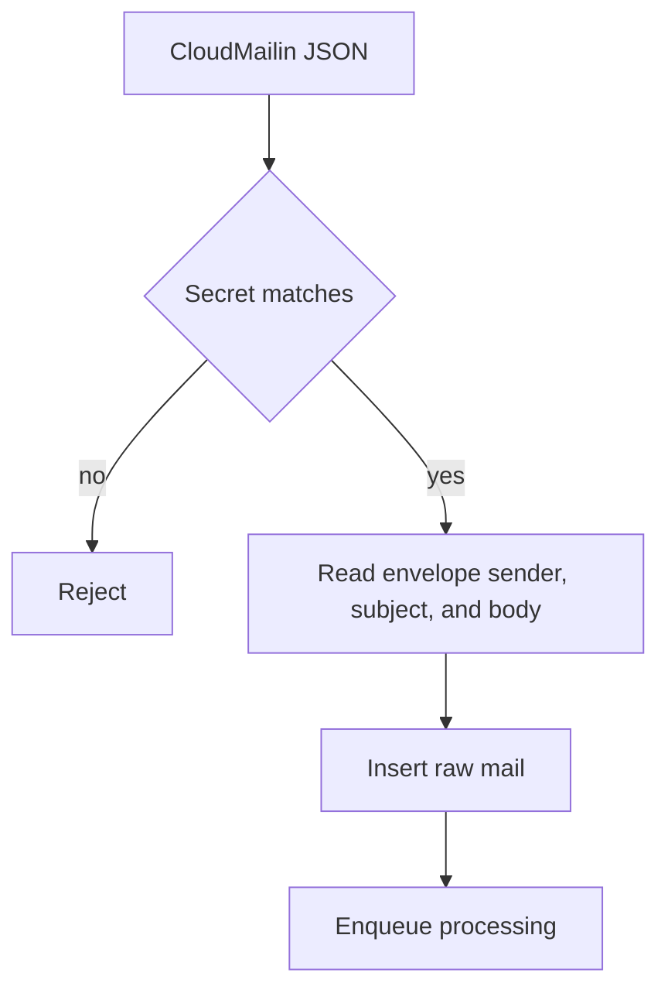

### POST /api/v1/intake/emails

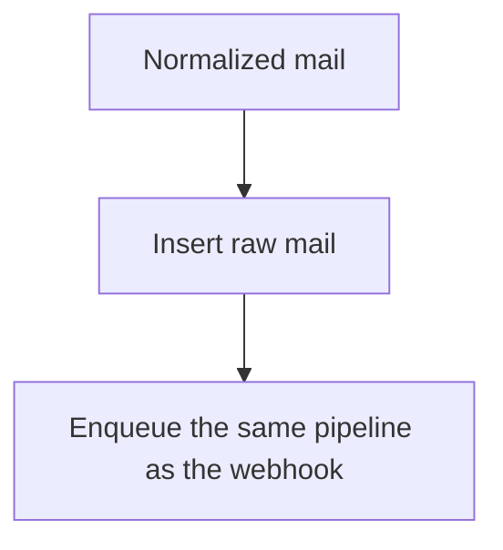

### POST /api/v1/intake/emails/{event_id}/process

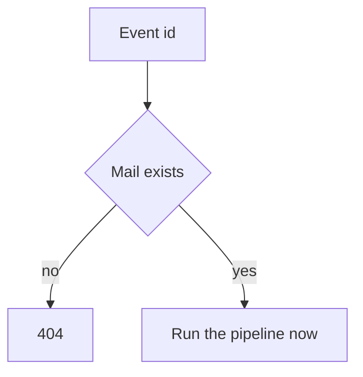

### GET /api/v1/intake/emails

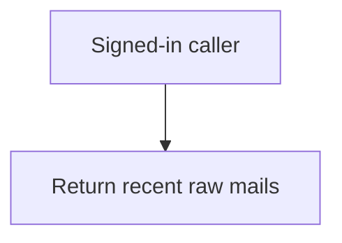

### POST /api/v1/intake/worker/tick

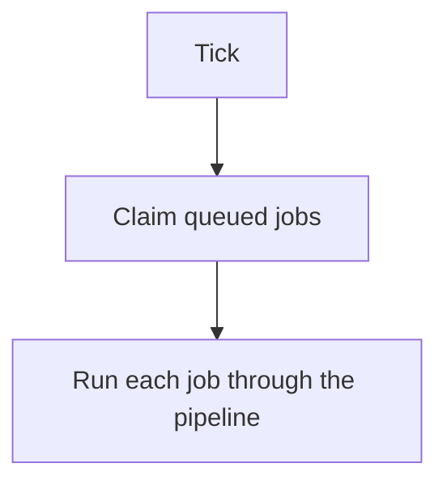

## 4. The desk decides

After a known employee is accepted, the desk reads records before it writes the case. Missing records stay unknown. The desk does not invent a warranty, a repair count, or an amount.

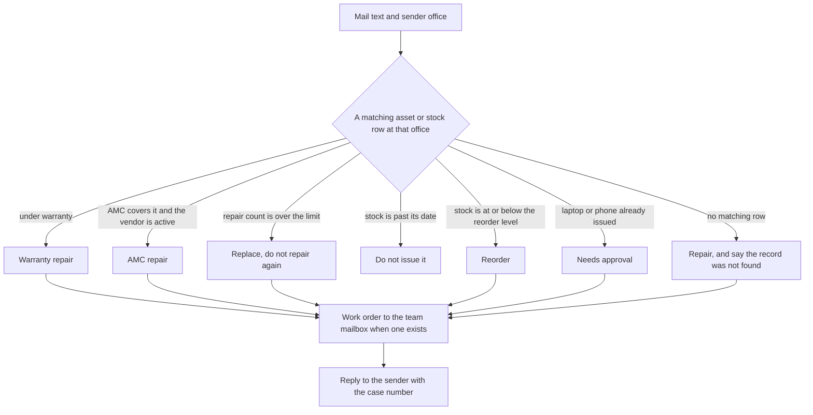

The facilities team is named on the work order. The desk does not email an HVAC vendor to come and fix the unit. Vendor mail from this system is for invite, activation, suspension, and stock reorder.

Meeting rooms are busy when a booking overlaps, with status held or confirmed. There is no room sensor.

## 5. Console chat and Excel

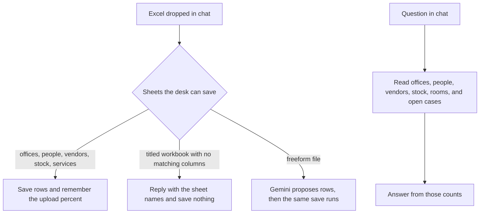

Upload percent is rows saved in that file divided by rows in that file. It is not “the company is finished.”

| Method | Path | What happens |
| --- | --- | --- |
| POST | `/api/v1/desk/chat` | Answers from the company snapshot. |
| POST | `/api/v1/desk/chat/file` | Reads one workbook, saves what it can, and replies with what changed. |
| GET | `/api/v1/setup/status` | Company name, admin mailbox source, and the last Excel percent. |
| GET | `/api/v1/setup/templates/company` | Workbook template for a full company import. |
| GET | `/api/v1/setup/templates/{kind}` | CSV template for one kind. |
| POST | `/api/v1/setup/import/company` | Preview, or commit when `commit=true`. |
| POST | `/api/v1/setup/import/{kind}` | Preview or commit one kind. |

### POST /api/v1/desk/chat

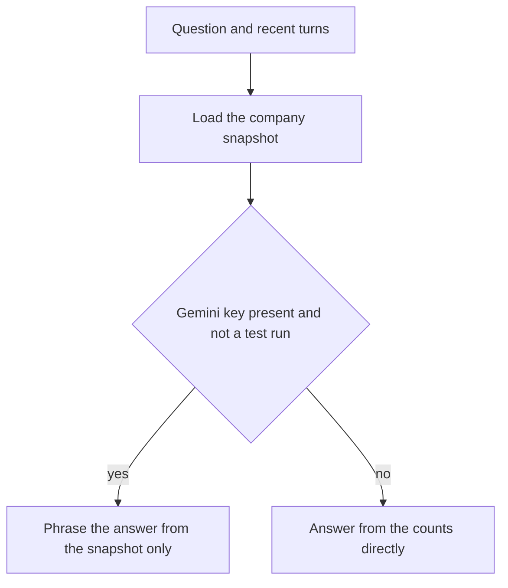

### POST /api/v1/desk/chat/file

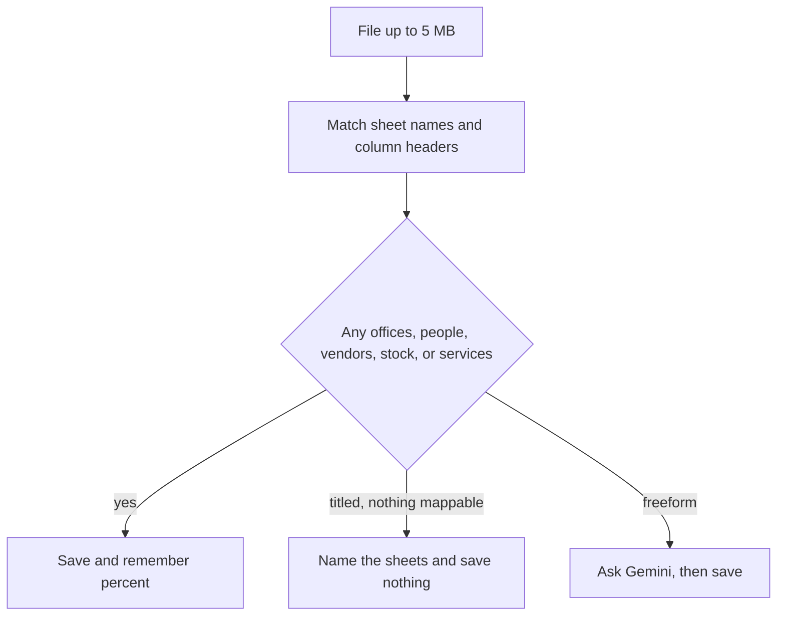

### POST /api/v1/setup/import/company

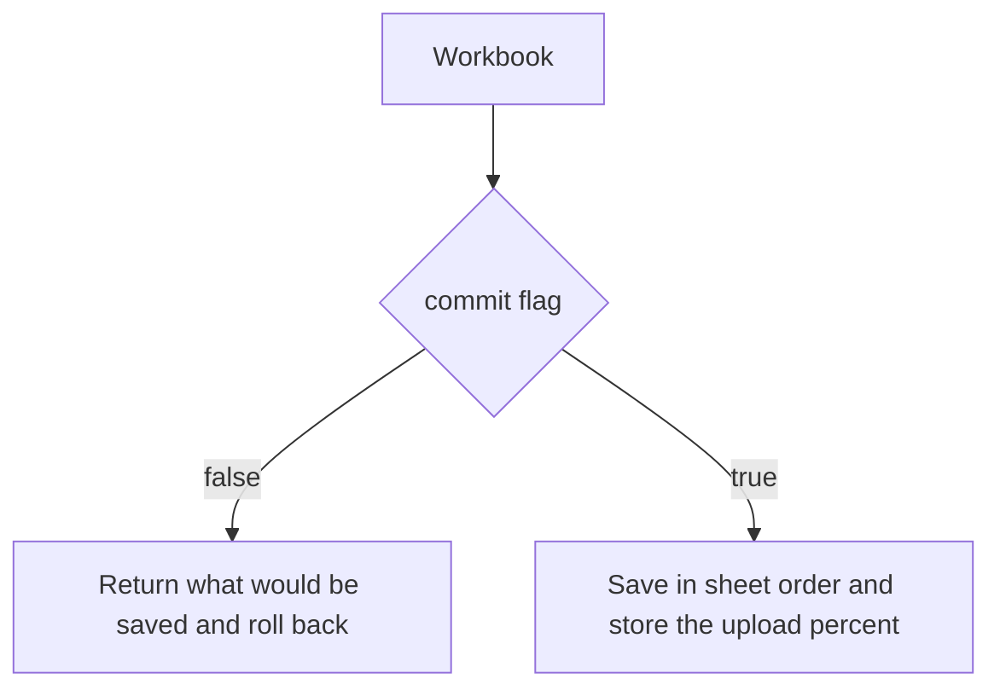

Sheet order is locations, departments, employees, resources, vendors, stock, knowledge, site services, then cost centres. A location whose parent code is not in the file is skipped until that parent exists.

## 6. Cases the console can see

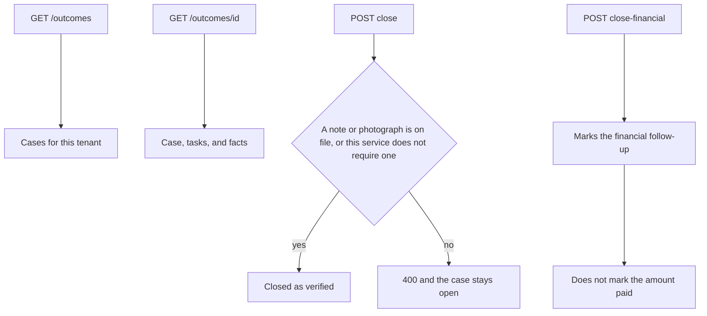

| Method | Path | What happens |
| --- | --- | --- |
| GET | `/api/v1/dashboard/kpis` | Open cases, decisions waiting, and whether outbound mail is configured. |
| GET | `/api/v1/outcomes` | List cases. |
| GET | `/api/v1/outcomes/{outcome_id}` | One case. |
| POST | `/api/v1/outcomes/{outcome_id}/close` | Close it only when a note or photograph is on file, or the service does not require proof. Otherwise the case stays open. |
| POST | `/api/v1/outcomes/{outcome_id}/reopen` | Open it again. |
| POST | `/api/v1/outcomes/{outcome_id}/confirm-booking` | Confirm a held meeting-room booking. |
| POST | `/api/v1/outcomes/{outcome_id}/resend-clarification` | Send the clarification again. |
| POST | `/api/v1/outcomes/{outcome_id}/override-facts` | An operator replaces extracted facts and the change is audited. |
| GET | `/api/v1/tasks` | List tasks on cases. |
| POST | `/api/v1/tasks/{task_id}/status` | Move one task. |
| POST | `/api/v1/evidence` | Attach a note or file reference to a case. |
| POST | `/api/v1/evidence/{evidence_id}/verify` | Mark that evidence checked. |
| POST | `/api/v1/approvals/{approval_id}/decide` | Approve or reject from the console. |
| POST | `/api/v1/outcomes/{outcome_id}/close-financial` | Close the money follow-up. The amount stays reported. |
| POST | `/api/v1/exceptions/{exception_id}/resolve` | Close a billing or match exception. |
| GET | `/api/v1/reviews` | Queue of items a person must decide. |
| POST | `/api/v1/reviews/{review_id}/decide` | Record that decision. |

### GET /api/v1/dashboard/kpis

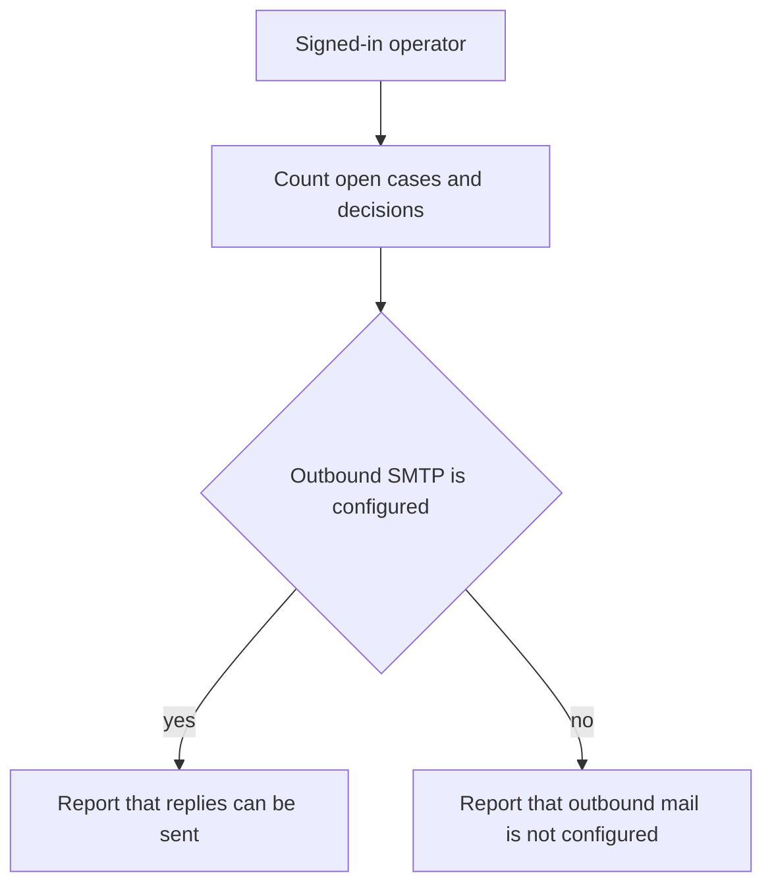

### POST /api/v1/outcomes/{outcome_id}/close

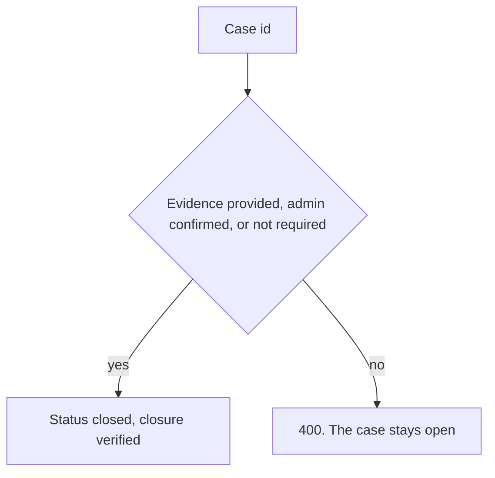

### POST /api/v1/outcomes/{outcome_id}/close-financial

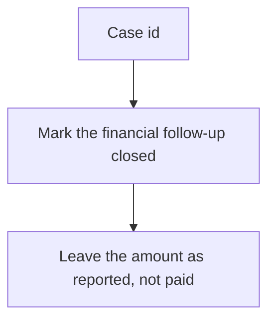

### POST /api/v1/approvals/{approval_id}/decide

```mermaid
flowchart TD
    body[Approve or reject] --> row{Approval is still open}
    row -->|no| stop[Refuse]
    row -->|yes| write[Store the decision and continue the case]
```

### GET /api/v1/public/approvals/{approval_id}/{decision}

```mermaid
flowchart TD
    link[Link from an approval mail] --> page[Show the approve or reject page]
```

### POST /api/v1/public/approvals/{approval_id}/{decision}

```mermaid
flowchart TD
    click[The approver submits the page] --> token{Link is still valid}
    token -->|yes| save[Store the decision]
    token -->|no| expired[Tell them the link is no longer valid]
```

## 7. Company records

These routes are the console editors for the rows the desk reads. Each one is signed in. A write is audited.

### Offices, teams, and services

| Method | Path | What happens |
| --- | --- | --- |
| GET | `/api/v1/setup/locations` | List the place tree. |
| POST | `/api/v1/setup/locations` | Add a region, city, branch, building, or floor. |
| PATCH | `/api/v1/setup/locations/{location_id}` | Rename or move it. |
| DELETE | `/api/v1/setup/locations/{location_id}` | Remove it when nothing still depends on it. |
| GET | `/api/v1/setup/departments` | List teams and their mailboxes. |
| POST | `/api/v1/setup/departments` | Add a team. The mailbox is where work orders go. |
| PATCH | `/api/v1/setup/departments/{department_id}` | Change the team. |
| DELETE | `/api/v1/setup/departments/{department_id}` | Remove the team. |
| GET | `/api/v1/setup/knowledge` | List answers the desk may quote. |
| PUT | `/api/v1/setup/knowledge` | Replace the knowledge set. |
| DELETE | `/api/v1/setup/knowledge/{entry_id}` | Remove one answer. |
| GET | `/api/v1/setup/site-services` | List services offered at a site. |
| PUT | `/api/v1/setup/site-services` | Replace that list. An empty site becomes Corporate Office. |
| GET | `/api/v1/setup/cost-centres` | List cost centres and approvers. |
| PUT | `/api/v1/setup/cost-centres` | Replace that list. |
| GET | `/api/v1/setup/tickets` | List request templates. |
| GET | `/api/v1/setup/visitors` | List visitor defaults. |
| GET | `/api/v1/entities` | List legal entities. |
| POST | `/api/v1/entities` | Add one. |
| GET | `/api/v1/entities/{entity_id}` | Read one. |
| PATCH | `/api/v1/entities/{entity_id}` | Update one. |

```mermaid
flowchart TD
    edit[Create or update a company row] --> check{Required fields are present}
    check -->|no| error[Return the missing field]
    check -->|yes| save[Write the row]
    save --> audit[Append an audit line]
```

### Assets and rooms

| Method | Path | What happens |
| --- | --- | --- |
| GET | `/api/v1/assets` | List assets. Warranty and repair counts are read from these rows. |
| POST | `/api/v1/assets` | Add an asset at an office. |
| POST | `/api/v1/assets/{asset_id}/status` | Change status. |
| POST | `/api/v1/assets/{asset_id}/reassign` | Move it to another person. |
| GET | `/api/v1/ops/resources` | List bookable rooms and seats. |
| GET | `/api/v1/workplace/seats/available` | Seats free at an office. |
| POST | `/api/v1/workplace/seats/allocate` | Give a seat to a person. |
| POST | `/api/v1/workplace/seats/{resource_id}/release` | Free that seat. |
| POST | `/api/v1/workplace/visitors/{pass_id}/check-in` | Mark a visitor in. |
| POST | `/api/v1/workplace/visitors/{pass_id}/check-out` | Mark a visitor out. |

```mermaid
flowchart TD
    asset[Asset write] --> place{Office exists}
    place -->|no| stop[Refuse]
    place -->|yes| row[Save tag, type, and warranty date]
    room[Room booking check] --> overlap{Another held or confirmed booking overlaps}
    overlap -->|yes| busy[Room is busy]
    overlap -->|no| free[Room can be booked]
```

## 8. Vendors

```mermaid
flowchart TD
    invite[POST /vendors/invite] --> mail[Mail the vendor a registration link]
    mail --> form[Vendor opens /vendor-register/token — same 6-step wizard]
    company[Company /vendors/onboarding/id] --> draft[GET/PUT onboarding draft]
    form --> draft
    draft --> submit[POST onboarding/submit]
    submit --> review[Operator activates or suspends]
    review --> active[ACTIVE vendors can be named on a work order]
```

Empty coverage means the vendor is usable at every office. An invite does not lock the vendor to the inviter’s offices. Company and vendor share one onboarding JSON draft and the same six-step UI.

| Method | Path | What happens |
| --- | --- | --- |
| GET | `/api/v1/vendors` | List vendors. |
| GET | `/api/v1/vendors/{vendor_id}` | One vendor. |
| POST | `/api/v1/vendors/invite` | Send the registration mail with the six-step onboarding link. |
| GET | `/api/v1/vendors/{vendor_id}/onboarding` | Load the company onboarding draft. |
| PUT | `/api/v1/vendors/{vendor_id}/onboarding` | Save the company onboarding draft. |
| POST | `/api/v1/vendors/{vendor_id}/onboarding/submit` | Submit the draft for review. |
| GET | `/api/v1/public/vendors/register/{token}` | Vendor opens the same six-step form from the invite mail. |
| PUT | `/api/v1/public/vendors/register/{token}` | Vendor saves a draft. |
| POST | `/api/v1/public/vendors/register/{token}/submit` | Vendor submits for company review. |
| POST | `/api/v1/vendors/{vendor_id}/resend-invite` | Send that mail again. |
| PATCH | `/api/v1/vendors/{vendor_id}` | Update the vendor. |
| PUT | `/api/v1/vendors/{vendor_id}/coverage` | Set the offices they cover. |
| POST | `/api/v1/vendors/{vendor_id}/score` | Add a score. |
| POST | `/api/v1/vendors/{vendor_id}/activate` | Mark them active and mail them. |
| POST | `/api/v1/vendors/{vendor_id}/suspend` | Mark them suspended and mail them. |
| GET | `/api/v1/vendors/{vendor_id}/scorecard` | Read the scorecard. |
| GET | `/api/v1/ops/vendors` | Short vendor list for the ops screens. |

### POST /api/v1/vendors/invite

```mermaid
flowchart TD
    body[Vendor email and optional cities] --> row[Create the vendor as invited]
    row --> send[Send the registration link]
```

### POST /api/v1/vendors/{vendor_id}/activate

```mermaid
flowchart TD
    id[Vendor id] --> state{Registration is complete}
    state -->|no| stop[Refuse]
    state -->|yes| active[Status ACTIVE]
    active --> mail[Mail the vendor]
```

### GET/PUT /api/v1/public/vendors/register/{token} · POST …/submit

```mermaid
flowchart TD
    token{Invite token is valid} -->|no| stop[Refuse]
    token -->|yes| wizard[Load or save the shared 6-step onboarding draft]
    wizard --> submit[POST /submit marks the draft submitted]
```

## 9. Money, purchase, and stock masters

Reported spend is written when a team replies “done, INR …”. Nothing in this section marks that amount paid. Payment stays with the external ERP.

```mermaid
flowchart TD
    done[Team reply includes an amount] --> report[Store it as reported spend]
    report --> ledger[Ops ledger remembers the note]
    invoice[Invoice mail quoting the case] --> match[Match it to the case]
    match --> post[POST match-and-post can hand a matched invoice to the ERP stub]
    post --> paid[The stub accepts the post and does not invent a payment]
```

| Method | Path | What happens |
| --- | --- | --- |
| GET | `/api/v1/budgets` | List budgets. |
| POST | `/api/v1/budgets` | Create a budget. |
| POST | `/api/v1/budgets/reserve` | Reserve an amount. |
| POST | `/api/v1/budgets/commit` | Commit a reservation. |
| POST | `/api/v1/budgets/accrue` | Accrue. |
| POST | `/api/v1/budgets/actual` | Record an actual. |
| POST | `/api/v1/budgets/transfer` | Move budget between centres. |
| POST | `/api/v1/p2p/purchase-requests` | Open a purchase request. |
| POST | `/api/v1/p2p/purchase-orders` | Open a purchase order. |
| GET | `/api/v1/p2p/purchase-orders` | List purchase orders. |
| POST | `/api/v1/p2p/grn` | Record goods received and add the quantity to stock. |
| POST | `/api/v1/p2p/ses` | Record a service entry. |
| POST | `/api/v1/p2p/invoices/{invoice_id}/match-and-post` | Match the invoice and hand it to the ERP connector. |
| GET | `/api/v1/ops/invoices` | List invoices. |
| POST | `/api/v1/ops/invoices/{invoice_id}/erp-handoff` | Send one invoice toward the ERP connector. |
| POST | `/api/v1/sourcing/requirements` | Open a sourcing requirement. |
| POST | `/api/v1/sourcing/requirements/{requirement_id}/rfq` | Ask vendors to quote. |
| POST | `/api/v1/sourcing/rfq/{rfq_id}/quotes` | Store a quote. |
| GET | `/api/v1/sourcing/rfq/{rfq_id}/compare` | Compare quotes. |
| POST | `/api/v1/sourcing/rfq/{rfq_id}/award/{quote_id}` | Award one quote. |
| POST | `/api/v1/facilities/inventory/items` | Add a stock item. |
| POST | `/api/v1/facilities/inventory/entitlements` | Who may draw that item. |
| GET | `/api/v1/facilities/inventory/entitlements/check` | Check one person against that rule. |
| POST | `/api/v1/facilities/inventory/cycle-counts` | Store a count. |
| GET | `/api/v1/facilities/inventory/expiring` | Items whose expiry is near. |
| POST | `/api/v1/outcomes/{outcome_id}/cost/report` | Store a reported cost on the case. |
| GET | `/api/v1/outcomes/{outcome_id}/cost` | Read that reported cost. |

### POST /api/v1/budgets/reserve

```mermaid
flowchart TD
    amount[Centre, period, amount] --> room{Budget has room}
    room -->|no| stop[Refuse]
    room -->|yes| hold[Increase the reserved amount]
```

### POST /api/v1/p2p/grn

```mermaid
flowchart TD
    goods[Purchase order line and quantity] --> sku[Find the stock row]
    sku --> add[Add the received quantity to qty on hand]
```

### POST /api/v1/p2p/invoices/{invoice_id}/match-and-post

```mermaid
flowchart TD
    inv[Invoice id] --> match{It matches a service entry or order}
    match -->|no| exception[Leave it as an exception]
    match -->|yes| erp[Post ACCEPTED to the ERP connector]
    erp --> unpaid[Do not set the invoice to paid]
```

### GET /api/v1/facilities/inventory/expiring

```mermaid
flowchart TD
    call[Signed-in caller] --> rows[Return stock whose expiry date is inside the window]
```

## 10. Facilities, fleet, and projects

These are console and integrator routes. Daily employee requests still enter through mail.

| Method | Path | What happens |
| --- | --- | --- |
| POST | `/api/v1/facilities/pm-schedules` | Create a planned maintenance schedule. |
| POST | `/api/v1/facilities/pm-schedules/{schedule_id}/complete` | Mark that visit done. |
| GET | `/api/v1/facilities/pm-schedules/overdue` | Schedules past their date. |
| POST | `/api/v1/facilities/soft-rounds` | Record a soft-services round. |
| POST | `/api/v1/facilities/incidents` | Open an incident. |
| PUT | `/api/v1/facilities/locations/{location_id}/profile` | Save the site profile. |
| GET | `/api/v1/facilities/locations/{location_id}/completeness` | Which profile fields are still empty. |
| POST | `/api/v1/facilities/spaces` | Add a space. |
| GET | `/api/v1/facilities/spaces` | List spaces. |
| POST | `/api/v1/facilities/catalogue` | Add a catalogue item. |
| GET | `/api/v1/facilities/catalogue` | List the catalogue. |
| POST | `/api/v1/facilities/assets/{asset_id}/enrich` | Fill asset attributes. |
| GET | `/api/v1/facilities/assets/{asset_id}/completeness` | Which asset fields are still empty. |
| POST | `/api/v1/facilities/amc/vendor-call` | Queue an AMC vendor call. This does not by itself replace the facilities work order. |
| POST | `/api/v1/facilities/job-plans` | Save a job plan. |
| POST | `/api/v1/facilities/soft-schedules` | Save a soft-service schedule. |
| POST | `/api/v1/facilities/soft-schedules/generate` | Generate rounds from that schedule. |
| POST | `/api/v1/facilities/soft-rounds/{round_id}/complete-ses` | Complete a round and its service entry. |
| POST | `/api/v1/facilities/work-orders` | Open a facilities work order directly. |
| POST | `/api/v1/facilities/work-orders/{work_order_id}/advance` | Move it to the next step. |
| POST | `/api/v1/facilities/chargeback/rules` | Save a chargeback rule. |
| POST | `/api/v1/facilities/chargeback/rules/{code}/allocate` | Run that allocation. |
| POST | `/api/v1/facilities/compliance` | Save a compliance item. |
| GET | `/api/v1/facilities/compliance/due` | Items that are due. |
| POST | `/api/v1/facilities/risks` | Save a risk. |
| POST | `/api/v1/facilities/bcp/plans` | Save a continuity plan. |
| POST | `/api/v1/facilities/bcp/plans/{plan_id}/drills` | Record a drill. |
| POST | `/api/v1/facilities/esg/metrics` | Save an ESG metric. |
| GET | `/api/v1/facilities/dashboard` | Facilities counts. |
| POST | `/api/v1/amc/obligations` | Add an AMC obligation. |
| GET | `/api/v1/amc/obligations` | List them. |
| POST | `/api/v1/projects` | Open a project. |
| POST | `/api/v1/projects/{project_id}/status` | Change project status. |
| POST | `/api/v1/fleet/vehicles` | Add a vehicle. |
| POST | `/api/v1/fleet/trips` | Open a trip. |
| POST | `/api/v1/fleet/trips/{trip_id}/complete` | Complete a trip. |
| POST | `/api/v1/travel/itineraries` | Open an itinerary. |
| POST | `/api/v1/travel/itineraries/{itinerary_id}/book` | Mark it booked. |
| POST | `/api/v1/admin-modules/mail` | Run a mail-admin action. |
| POST | `/api/v1/admin-modules/lifecycle` | Start a lifecycle case. |
| POST | `/api/v1/admin-modules/lifecycle/{case_id}/complete/{code}` | Complete one lifecycle step. |
| POST | `/api/v1/admin-modules/utilities` | Record a utility reading from the admin module. |

### POST /api/v1/facilities/work-orders

```mermaid
flowchart TD
    body[Office, trade, and description] --> row[Create the work order]
    row --> team[It sits with facilities until advanced]
```

### POST /api/v1/facilities/work-orders/{work_order_id}/advance

```mermaid
flowchart TD
    id[Work order id] --> step[Move to the next status]
    step --> save[Save the new status]
```

### POST /api/v1/facilities/amc/vendor-call

```mermaid
flowchart TD
    body[Asset and AMC vendor] --> queue[Enqueue AMC vendor call]
    queue --> mail{Vendor email is on the vendor row}
    mail -->|yes| note[The call is queued for that address]
    mail -->|no| hold[The call has nowhere to go]
```

### GET /api/v1/facilities/locations/{location_id}/completeness

```mermaid
flowchart TD
    id[Office id] --> fields[Compare the profile with the required fields]
    fields --> gaps[Return the missing ones]
```

### POST /api/v1/fleet/trips/{trip_id}/complete

```mermaid
flowchart TD
    id[Trip id] --> done[Mark the trip complete]
    done --> save[Store the closing details]
```

## 11. Contracts, learning, and the outbox

| Method | Path | What happens |
| --- | --- | --- |
| POST | `/api/v1/contracts/{contract_id}/amendments` | Store an amendment. |
| POST | `/api/v1/contracts/{contract_id}/terminate` | Store a termination. |
| POST | `/api/v1/vendors/{vendor_id}/workspace` | Open a vendor workspace item: quote, evidence, invoice, or progress. |
| POST | `/api/v1/vendor-workspace/{item_id}/decide` | Accept or reject that item. |
| POST | `/api/v1/sourcing/rfq/{rfq_id}/sealed-score` | Score quotes without showing them early. |
| POST | `/api/v1/utilities/meters` | Add a meter. |
| POST | `/api/v1/esg/waste-manifests` | Store a waste manifest. |
| POST | `/api/v1/esg/carbon` | Store a carbon figure. |
| POST | `/api/v1/learning/{record_id}/sign-off` | A person signs a learning record. |
| GET | `/api/v1/learning/summary` | What the desk has suggested learning. |
| POST | `/api/v1/learning/suggestions/apply` | Apply one suggestion. |
| POST | `/api/v1/learning/knowledge/{entry_id}/approve` | Approve a learned answer. |
| POST | `/api/v1/learning/knowledge/{entry_id}/reject` | Reject it. |
| POST | `/api/v1/learning/eval/run` | Run the evaluation set. |
| GET | `/api/v1/outbox/dead-letters` | Outbound jobs that stopped retrying. |
| POST | `/api/v1/outbox/dead-letters/{outbox_id}/requeue` | Try that job again. |
| POST | `/api/v1/integrations/erp/reconcile` | Compare posted invoices with the ERP connector. |
| GET | `/api/v1/control-tower/summary` | One page of open work, failures, and queues. |

### POST /api/v1/contracts/{contract_id}/amendments

```mermaid
flowchart TD
    id[Contract id and the change] --> row[Append the amendment]
    row --> keep[The old terms stay in the history]
```

### POST /api/v1/vendor-workspace/{item_id}/decide

```mermaid
flowchart TD
    item[Workspace item] --> choice{Accept or reject}
    choice -->|accept| in[Item becomes accepted]
    choice -->|reject| out[Item becomes rejected]
```

### POST /api/v1/outbox/dead-letters/{outbox_id}/requeue

```mermaid
flowchart TD
    id[Dead letter id] --> reset[Put the job back on the queue]
    reset --> later[The worker tries the send again]
```

### GET /api/v1/control-tower/summary

```mermaid
flowchart TD
    call[Signed-in operator] --> gather[Read open cases, failed jobs, and review counts]
    gather --> page[Return one summary]
```

## 12. Policies, AI, and housekeeping

| Method | Path | What happens |
| --- | --- | --- |
| GET | `/api/v1/policies` | List business rules. |
| POST | `/api/v1/policies` | Add a rule. Record limits live here when they are set. |
| PATCH | `/api/v1/policies/{policy_id}/deactivate` | Turn a rule off. |
| GET | `/api/v1/ops/config/templates` | List outcome templates. |
| GET | `/api/v1/ops/config/rules` | List active rules. |
| GET | `/api/v1/ops/config/notifications` | List notification settings. |
| GET | `/api/v1/ops/policy/meeting-room` | The meeting-room rule the desk uses. |
| GET | `/api/v1/ops/ai/health` | Whether Gemini is configured and a tiny call works. |
| GET | `/api/v1/ops/ai/probe` | Try each key and model and return the provider error, if any. |
| GET | `/api/v1/ops/failures` | Failed processing jobs. |
| POST | `/api/v1/ops/failures/{job_id}/reprocess` | Run that job again. |
| POST | `/api/v1/ops/sla/tick` | Send reminders and escalations that are due. |
| POST | `/api/v1/ops/agent/digest` | Mail the admin digest. |
| POST | `/api/v1/ops/holds/sweep` | Release holds that have expired. |
| POST | `/api/v1/ops/evals/meeting-room` | Run the meeting-room checks. |
| POST | `/api/v1/ops/demo/reset` | Clear operational mail and cases. Company master rows stay. Company admin only. |

### GET /api/v1/ops/ai/health

```mermaid
flowchart TD
    call[Signed-in operator] --> key{A Gemini key is set}
    key -->|no| heuristic[Report that the fixed reader is in use]
    key -->|yes| ping[Make a tiny Gemini call]
    ping --> result[Return ok or the provider error]
```

### POST /api/v1/ops/failures/{job_id}/reprocess

```mermaid
flowchart TD
    id[Failed job] --> reset[Mark it queued]
    reset --> run[The pipeline runs that mail again]
```

### POST /api/v1/ops/demo/reset

```mermaid
flowchart TD
    who{Caller is a company admin} -->|no| stop[Refuse]
    who -->|yes| clear[Delete cases, mail, and bookings]
    clear --> keep[Keep offices, people, vendors, and stock]
```

## 13. Gmail and Outlook connectors

The live intake path is CloudMailin. These routes connect a mailbox the old poller can read. They are not required for the CloudMailin door.

| Method | Path | What happens |
| --- | --- | --- |
| GET | `/api/v1/integrations/gmail/status` | Whether Gmail OAuth is connected. |
| GET | `/api/v1/integrations/gmail/connect` | Start the Google consent page. |
| GET | `/api/v1/integrations/gmail/callback` | Store the token after consent. |
| POST | `/api/v1/integrations/gmail/poll` | Pull unread mail into the same pipeline. |
| DELETE | `/api/v1/integrations/gmail/disconnect` | Remove the Gmail token. |
| GET | `/api/v1/integrations/outlook/status` | Whether Outlook is connected. |
| GET | `/api/v1/integrations/outlook/connect` | Start the Microsoft consent page. |
| GET | `/api/v1/integrations/outlook/callback` | Store the token after consent. |
| POST | `/api/v1/integrations/outlook/poll` | Pull unread mail into the same pipeline. |
| DELETE | `/api/v1/integrations/outlook/disconnect` | Remove the Outlook token. |

### GET /api/v1/integrations/gmail/connect

```mermaid
flowchart TD
    call[Signed-in operator] --> app{Gmail client id is set}
    app -->|no| stop[Tell them it is not configured]
    app -->|yes| url[Return the Google consent URL]
```

### POST /api/v1/integrations/gmail/poll

```mermaid
flowchart TD
    token{Gmail is connected} -->|no| stop[Refuse]
    token -->|yes| unread[Read unread messages]
    unread --> each[Each message enters the same pipeline as CloudMailin]
```

### GET /api/v1/integrations/outlook/connect

```mermaid
flowchart TD
    call[Signed-in operator] --> app{Outlook client id is set}
    app -->|no| stop[Tell them it is not configured]
    app -->|yes| url[Return the Microsoft consent URL]
```

### POST /api/v1/integrations/outlook/poll

```mermaid
flowchart TD
    token{Outlook is connected} -->|no| stop[Refuse]
    token -->|yes| unread[Read unread messages]
    unread --> each[Each message enters the same pipeline as CloudMailin]
```

## What this map does not turn on

Lease commercial masters, mobile check-in, and IoT sensors are out of scope. A vendor is not mailed to perform an AC repair. An empty vendor coverage row still means every office. Publishing this folder is what makes the live server follow this map.
